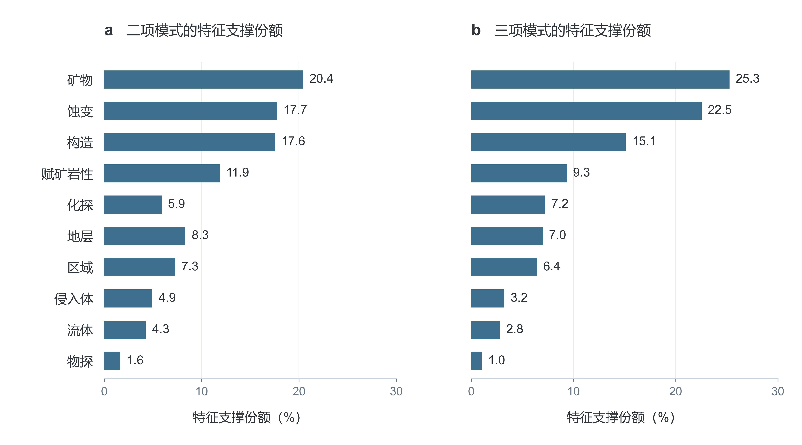

# 新疆金矿床勘查标识关联挖掘

论文 **《基于多阶段大语言模型的新疆金矿床勘查标识知识图谱构建与关联挖掘》** 的关联挖掘实验与图表复现代码。作者：**曹颖**。

[English overview](README_EN.md) · [方法说明](docs/method.md) · [数据字典](docs/data.md) · [复现指南](docs/reproducibility.md) · [图件索引](docs/figures.md)

本项目从处理后的新疆金矿床属性 CSV 出发，合并同名来源记录，挖掘跨特征的二项与三项正共现模式，通过分组证据分配计算特征和属性支撑份额，并生成论文结果图。另提供二项、三项模式分别计算的特征支撑份额及其与全库结果的重构核验。

**范围：** 本仓库提供处理后数据、关联挖掘、结果追溯和图表复现。不包含上游多阶段大语言模型抽取、原始 PDF 文献、知识图谱数据库或模型服务配置。当前份额描述固定模式库的证据分配，不是找矿预测准确率或因果效应。

## 主要结果

| 指标 | 数值 |
|---|---:|
| 来源记录 | 355 |
| 矿床名称组 | 76 |
| 分析特征 | 10 |
| 类型化属性值 | 1,037 |
| 二项正共现模式 | 1,398 |
| 三项正共现模式 | 10,565 |
| 正共现模式合计 | 11,963 |
| 总证据量 | 388.8005790848142 |



左侧为二项模式，右侧为三项模式，两侧分别归一化到 100%，按原合计份额统一排列。原合计份额可由二项份额乘 **8.23596974%** 与三项份额乘 **91.76403026%** 后相加还原。两个权重来自证据总量，不是模式数量比例。

## 快速开始

以下命令均在仓库根目录运行。无需下载模型、访问 API 或连接数据库。

### 1 安装绘图依赖

已验证环境为 Python 3.13.5、Matplotlib 3.10.0、NumPy 2.1.3、Pillow 11.1.0。建议在独立 Python 环境中安装：

```bash
python -m pip install -r requirements-reproduced.txt
```

`requirements.txt` 给出允许的依赖范围，`requirements-reproduced.txt` 记录本次实际验证的直接依赖版本。后者不是包含全部传递依赖的锁文件。

绘制中文图需要安装 Microsoft YaHei、Noto Sans CJK SC、Source Han Sans CN 或 SimHei 中的一种字体。原图使用 Microsoft YaHei 与 Arial；字体不同可能改变布局和 PNG 字节，数值结果不受影响。

### 2 一次生成全部结果和四张图

```bash
python scripts/reproduce.py --output runs/my-reproduction
```

此命令重新解析 CSV、挖掘模式、生成中间数据与结果、导出表格、计算阶数分解、绘制 F1—F4，并自动对照仓库内固定参考结果。`--output` 必须是尚不存在的目录，防止覆盖历史运行。

仅计算数值、暂不绘图时，无需安装第三方 Python 包或中文字体：

```bash
python scripts/reproduce.py --skip-figures --output runs/numerical-only
```

### 3 运行方法检查或复查已有运行

```bash
python -m unittest discover -s tests -v
python scripts/verify.py --run runs/my-reproduction
```

方法检查覆盖未知与显式空集合的区分，以及同组多属性联合事件的计数。完整实验还执行候选穷举、直接集合计数、分配守恒、基线回归与二项独立挖掘核验。

## 目录结构

```text
.
├── README.md / README_EN.md    # 使用入口
├── CITATION.cff                # 作者与论文题名
├── configs/baseline.json       # 固定输入版本、阈值和展示规则
├── data/
│   ├── processed/             # 处理后的来源记录 CSV
│   └── intermediate/          # F1—F3 全精度绘图输入
├── src/
│   ├── analysis/              # 解析、模式挖掘、分配、导表、阶数分解
│   └── plotting/              # 四张最终图的绘图代码
├── scripts/                   # 独立复现与结果核验入口
├── results/
│   ├── baseline/              # 名称组合并、全模式、成员关系、份额和证据
│   └── order_decomposition/   # 二项/三项子集、份额、重构核查
├── tables/                    # 论文表格与案例统计
├── figures/F1 ... F4/          # 最终 PNG、PDF、SVG、绘图数据及元数据
├── validation/                # 文件来源、哈希和实际验证记录
├── tests/                     # 手工可核算的方法测试
├── docs/                      # 方法、数据、复现、图件及整理依据
└── .github/workflows/          # 无需字体的数值复现 CI
```

仓库内 `results/`、`tables/`、`figures/` 是固定参考结果。新运行输出到 `runs/`，由 `.gitignore` 排除。中间实体表、来源映射和模式成员表保留在 `results/baseline/`，不再重复复制到 `data/intermediate/`。

## 四张结果图

| 编号 | 含义 | PNG | 代码 |
|---|---|---|---|
| F1 | 全部二项与三项模式的特征份额及观测覆盖率 | [查看](figures/F1/feature_support_coverage.png) | [plot_f1.py](src/plotting/plot_f1.py) |
| F2 | 六类特征内部 Top-5 属性份额 | [查看](figures/F2/feature_internal_support_v3.png) | [plot_f2.py](src/plotting/plot_f2.py) |
| F3 | 高证据模式、共同观测分母及 Group-Lift | [查看](figures/F3/high_order_pattern_forest_table.png) | [plot_f3.py](src/plotting/plot_f3.py) |
| F4 | 二项与三项分别计算的特征支撑份额 | [查看](figures/F4/feature_support_order2_order3.png) | [plot_f4.py](src/plotting/plot_f4.py) |

F1—F3 采用 10 月 4 日交付版的图件布局。F4 是补充实验的蓝色双面板图，显示数值保留一位小数。2026 年 11 月 16 日统一将特征 `HostRockUnit` 的中文图示标签改为“赋矿岩性”。各目录提供 600 dpi PNG、PDF 和 SVG。计算数据保持全精度。

## 结果核查

本地复现结果与本包的 22 个参考 CSV 和 4 张 PNG 逐字节一致。更新前后的参考 CSV 经统一中文标签后逐字节一致。两项方法测试通过。记录见 [发布验证](validation/release_validation.json) 与 [逐文件对照](validation/regression.json)。

跨平台复现按 `abs_tol=1e-12`、`rel_tol=1e-10` 核对 CSV 数值，字符串、标识和表结构须一致。PNG 字节一致性单独报告，不作为跨字体平台的数值正确性条件。PDF/SVG 会包含导出时间或自动标识，不要求二进制完全相同。

GitHub Actions 已配置仅数值复现；本地核验已运行，远程 CI 尚未运行。

## 解释与使用边界

- 355 行是来源记录，76 个样本是按规范化名称合并的名称组。合并不等于完成同名异矿或异名同矿的实体消歧。
- 未记录为未知，不作为阴性；同名来源按特征取并集。完整组合可能来自不同来源共同支持，应区分单来源与并集证据。
- Group-Lift 使用模式特定共同观测域。特征覆盖率是原数据观测比例，与证据份额不同。
- 本版本固定最多三项、次数门槛 3、共同观测门槛 10。没有新增抽取评估、显著性检验或预测实验。
- 案例可追溯至修订 CSV 行；原文页码与抽取语句未包含在此数据包中。
- 本仓库复现指定数据版本。更换数据需要同步检查论文数值断言、特征范围与最终图的固定布局，不能只更换 CSV 文件名。

## 引用

曹颖. **基于多阶段大语言模型的新疆金矿床勘查标识知识图谱构建与关联挖掘**.

机器可读引用信息见 [CITATION.cff](CITATION.cff)。未填写尚未提供的仓库地址、DOI、出版信息或许可证。

## 项目组织参考

本仓库采用数据、代码和产物分离的结构，参考 [Cookiecutter Data Science](https://github.com/drivendataorg/cookiecutter-data-science) 与 [Cookiecutter Reproducible Science](https://github.com/mkrapp/cookiecutter-reproducible-science)；复现说明与引用入口参考 [howfairis](https://github.com/fair-software/howfairis) 和 [GitHub 引用文件文档](https://docs.github.com/en/repositories/managing-your-repositorys-settings-and-features/customizing-your-repository/about-citation-files)。仅借鉴组织方式，不使用这些仓库的科学计算代码。详见 [整理记录](docs/organization.md)。

## LLM prompt
LLM相关prompt以及文献提取原始json文件，见LLM文件夹
