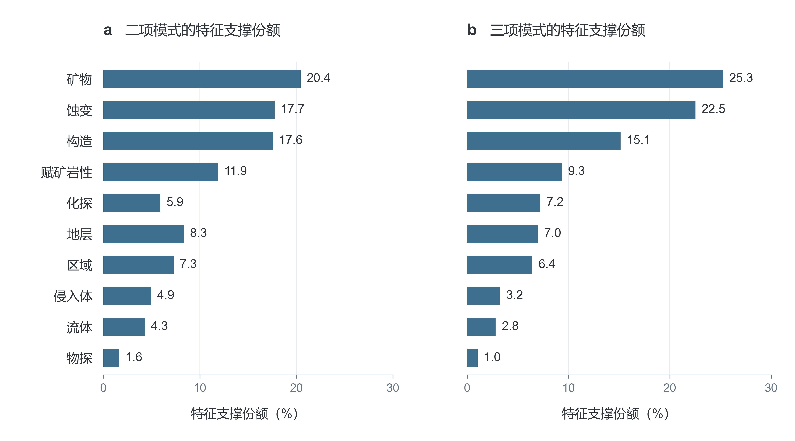

# Xinjiang gold-deposit pattern analysis

Research companion for **基于多阶段大语言模型的新疆金矿床勘查标识知识图谱构建与关联挖掘**, by **曹颖**.

[中文说明](README.md) · [Methods](docs/method.md) · [Data dictionary](docs/data.md)

This repository contains the processed attribute dataset, positive co-occurrence mining, grouped evidence allocation, order-specific analysis, intermediate tables, and four final figures. It starts from the processed CSV and does **not** include the upstream multi-stage LLM extraction or knowledge-graph infrastructure.

## Reproduce

Run from the repository root using Python 3.13 (tested: 3.13.5):

```bash
python -m pip install -r requirements-reproduced.txt
python scripts/reproduce.py --output runs/my-reproduction
```

A new output directory is required. For numerical reproduction only, no third-party packages are needed:

```bash
python scripts/reproduce.py --skip-figures --output runs/numerical-only
python -m unittest discover -s tests -v
```

Full plotting requires a supported CJK font: Microsoft YaHei, Noto Sans CJK SC, Source Han Sans CN, or SimHei. Original figures use Microsoft YaHei and Arial. Font differences may affect image layout and binary identity.

## Contents and results

- `data/processed/`: 355 source records, aggregated into 76 deposit-name groups and 10 feature categories.
- `results/baseline/`: 1,037 typed items and 11,963 positive patterns, including 1,398 pairs and 10,565 triples. Includes entity/source mappings and case evidence.
- `results/order_decomposition/`: order-specific feature scores and the reconstruction of the combined scores.
- `data/intermediate/`, `tables/`: plotting inputs and publication tables.
- `figures/F1`–`F4`: final PNG/PDF/SVG figures and their full-precision plotting data.
- `src/`, `scripts/`, `tests/`, `validation/`: portable computation, reproduction commands, method tests and recorded regression checks.



The two panels are normalized independently. Combined shares equal pair shares weighted by 8.23596974% plus triple shares weighted by 91.76403026%, using total evidence weights rather than pattern-count weights.

Local validation reproduced all 22 checked CSV files and all four PNG figures byte-for-byte. Other platforms use numerical tolerances for tabular comparisons; image identity is reported separately. The configured GitHub CI has not yet run remotely.

## Interpretation

These scores describe a fixed positive-pattern game, not predictive accuracy or causal effects. Missing values remain unknown. Deposit names are normalized and merged by union, without semantic entity resolution. Some co-occurrences arise only after merging multiple source records. Provenance reaches processed CSV rows, not original PDF passages.

## Citation

Use the supplied Chinese paper title and author in [CITATION.cff](CITATION.cff). Repository URL, DOI, publication metadata and licenses are not supplied.
